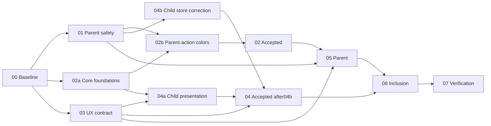

# Kế hoạch sửa toàn bộ audit giao diện

Execution authorization: user18/10/2026 yêu cầu OpenCode/GPT/Gemini/Kilo thực hiện tới khi xong. Các mặc định đã review trong plan được chấp thuận; giữ identity/multi-age/caregiver branches, commercial segment vẫn undecided/nonblocking. Không deploy production. Trạng thái planning-ready ở phần lịch sử phía dưới không phải completion implementation; tiến độ hiện tại trong handoffs và execution reports.

## Tiến độ thực thi hiện tại

Checkpoint cập nhật 19/10/2026: Phase 00–06 đã được nghiệm thu; Phase 07 đã kiểm chứng tích hợp Chromium, static gates, Cloudflare build/preview và performance budget. Gói bàn giao hiện là **implementation-verified / platform-gates-pending**, chưa commit hoặc deploy. Nguồn tiến độ: [Phase 07 handoff](handoffs/phase-07.md) và [coordinator acceptance](execution/phase07-root-acceptance.md).

Theo yêu cầu tiếp theo của người dùng, các native agents đang điều tra health production gián đoạn và hoàn tất kiểm chứng WebKit/Safari, accessibility và khả năng kiểm tra thiết bị thật. Kết quả bổ sung sẽ nằm trong `execution/phase08-*.md`; không suy ra hoàn tất gate chỉ từ việc giao agent. Các checkpoint chuyển phiên và planning bên dưới là lịch sử, không thay thế trạng thái hiện tại.

## Mục tiêu và phạm vi

Xử lý 9 nhóm phát hiện của audit 17/10/2026, kiểm chứng các quan sát phụ, và thiết kế lại bố cục thao tác bé/phụ huynh theo hướng “Nhật ký trưởng thành của gia đình”. Giữ sản phẩm, thương hiệu và các ranh giới tài khoản/PIN/ghép thiết bị; chưa thay thế bộ nhận diện. Đây là **kế hoạch**, không phải xác nhận đã sửa lỗi hay đã phát hành.

Nguồn gốc: [audit baseline có thể bàn giao](research/audit-baseline.md), sao từ snapshot `.impeccable/critique/2026-10-17T14-25-11Z__src-components-kiddashboard-tsx.md`; ảnh local `.omx/reports/ui-audit-2026-10-17/`. Điểm baseline chuyên gia 26/40 UX, 10/16 kỹ thuật không gồm hiệu năng. Đây không phải chứng nhận WCAG hay nghiên cứu hành vi. Nếu artifact local không có trên máy thực thi, tái chụp baseline, không đoán từ điểm số.

## Nguyên tắc và quyết định

1. Việc cần làm xuất hiện trước điểm, cấp độ và huy hiệu; nội dung luôn trung thực về pending/verified.
2. Một phạm vi rõ cho tổng quan, hàng đợi và bulk; thao tác server thành công mới xác nhận kết quả.
3. Tái dùng pattern/store/i18n/ModalShell hiện có; không thêm dependency hoặc abstraction lớn để sửa lỗi nhỏ.
4. Giữ các chức năng và nội dung factual; hướng dẫn dài được disclosure, không bị xóa để vừa màn hình.
5. Chỉ sửa vấn đề tái hiện được; warning màu/font/bounce không tự động là defect.

Ba yếu tố quyết định: an toàn thao tác phụ huynh, hành động đầu tiên rõ trên mobile, và nhận diện gia đình có thể lớn cùng trẻ.

Lựa chọn: **sửa theo lát nhỏ + thay thứ bậc trong thương hiệu hiện tại**. So với rebrand toàn bộ, cách này giữ tài sản tốt và giảm churn; đổi lại cần điều phối quyền sửa các file lớn. Chỉ vá CSS là phương án nhẹ hơn nhưng không giải quyết scope và task hierarchy. Không chọn rebrand vì chưa có PRODUCT.md/đối tượng trọng tâm được xác nhận và audit chưa chỉ ra thương hiệu hiện tại là sai.

Quyết định mặc định cho lập kế hoạch: đa nhóm tuổi, không chọn 3–8 hay 9–12 làm phân khúc thương mại; ageTheme vẫn theo flag hiện hữu. Phase 03 phải hoàn tất bước xác nhận product theo Impeccable trước khi viết PRODUCT.md hoặc thay một visual world. Các bugfix Phase 01–02 không phụ thuộc quyết định này.

## Phân công

| Vai trò | Công cụ/model | Trách nhiệm |
|---|---|---|
| Coordinator/integrator | GPT trong Codex hiện tại | DAG, phạm vi, giải quyết xung đột, nghiệm thu độc lập, handoff |
| Behavior executor | OpenCode, model theo cấu hình được xác nhận | Scope, mutation feedback, parent integration |
| Verification/theme executor | Kilo Code, model theo cấu hình được xác nhận | Regression tests; token/touch/motion theo lượt file ownership |
| Design/copy reviewer | AGY `gemini-3.8-flash-high` | Hợp lý theo tuổi, hierarchy, microcopy, đánh giá screenshot; không tự đổi factual copy |

Model chỉ có tên trong danh sách chưa có nghĩa gọi được; preflight cần một task có kết quả. Không thay Gemini trong AGY bằng Gemini qua CLI/provider khác mà mô tả như cùng đường chạy. Nếu một lane thiếu credit/auth/runtime, ghi rõ blocked, tiếp tục lane độc lập; không giả báo đã được multi-agent duyệt.

## Phase và handoff

| Phase | Đầu ra | Owner dự kiến → reviewer → người nhận | Phụ thuộc |
|---|---|---|---|
| [00 Baseline](phase-00-baseline.md) | Reproduction + regression map + flag manifest | Kilo → GPT → 01/02/03 | — |
| [01 Parent safety](phase-01-parent-safety.md) | Scope nhất quán, feedback lưu/lỗi | OpenCode → GPT/Kilo → 05 | 00 |
| [02 Visual foundations](phase-02-visual-foundations.md) | Contrast và dark surface hoàn chỉnh | Kilo → GPT → 04/05/06 | 00 |
| [03 UX contract](phase-03-ux-contract.md) | Product decision record + brief bé/phụ huynh | AGY Gemini + GPT → độc lập review → 04/05 | 00 |
| [04 Child experience](phase-04-child-experience.md) | Hành động đầu tiên, nhãn trạng thái, hierarchy | GPT executor → AGY/Kilo → 06/07 | 02,03 |
| [05 Parent experience](phase-05-parent-experience.md) | Inbox rõ phạm vi, tổng quan gọn | OpenCode → AGY/Kilo → 06/07 | 01,02,03 |
| [06 Inclusive interaction](phase-06-inclusive-interaction.md) | Touch, i18n, motion, semantics/focus | Kilo + OpenCode chia file → GPT/AGY → 07 | 04,05 |
| [07 Verification](phase-07-verification.md) | Gate report, re-audit, rollback/handoff | Kilo → GPT independent acceptance → release owner | 01–06 |

D08 execution refinement19Oct:04a may start after02a/03accepted and child-test preparation releases its files;04b store correction waits01release; whole04 remains unaccepted until both slices and full gates pass. Parent-only02b does not block child presentation. See decisions.md for exact ownership.

Parallelism chỉ khi file ownership không giao nhau:01/02-core/03 có thể cùng wave;02-parent-actions bắt buộc chờ01 accepted trước khi viết ParentApprovalsTab/BulkTaskReview;02 chỉ accepted sau cả hai slice.04/05 có thể cùng wave sau02/03. `globals.css`, `Header.tsx`, `ParentDashboard.tsx`, `KidDashboard.tsx`, cùng một copy file và cùng test file chỉ một người ghi tại một thời điểm. Phase02 có thể chỉnh style ParentDashboard sau khi01 xác nhận không sở hữu file này. Phase06 chỉ mở sau handoff04/05. GPT không sửa hộ khi worker đang giữ file.

Scope bổ sung đã quyết sau review: A04 được sửa contract async tối thiểu trong reward-actions/store declarations và caller tests vì action void không đủ để báo kết quả thật. Task single review tái dùng reviewLogs hiện có; redemption partial success phải giữ authoritative approved/unfulfilled state và recovery, không giả pending. Không mở rộng sang schema/domain/PIN hoặc thêm abstraction cho toàn store. Quyền ghi parent copy/tests cụ thể và child-heading/icon nằm trong phase specs.

## Coverage toàn bộ audit

| ID | Phát hiện | Nguồn code | Phase | Bằng chứng đóng |
|---|---|---|---|---|
| A01 P1 | Nhiệm vụ ở dưới fold | `KidDashboard.tsx:325–524,638`; `app/page.tsx:156` | 04 | Nhánh trẻ tự thao tác:task+nút nằm trọn375×812, demo/paired fixture;0–3/unknown có actor/action criteria riêng |
| A02 P1 | Scope chọn bé/hàng đợi | `ParentApprovalsTab.tsx:44–89,124`; `BulkTaskReview.tsx:20` | 01,05 | Hai bé có pending; đổi bé không review nhầm; bulk IDs đúng scope |
| A03 P1 | Contrast action | `HabitTimerModal.tsx:178,196`; `ParentDashboard.tsx:963`; `BulkTaskReview.tsx:117` | 02,07 | Computed foreground/background đạt4.5:1 chữ thường,3:1 large/nontext theo trường hợp |
| A04 P1 | Review feedback | `ParentApprovalsTab.tsx:105–106,140–141` | 01 | Slow/fail/retry/success, không gửi lặp, không báo thành công giả |
| A05 P2 | Dark surfaces | `globals.css:9–19,43–47,76–83`; `app/page.tsx:132–180` | 02 | Theme thực qua setting/system; shell/footer/callout đọc được, không nền sáng sót |
| A06 P2 | Nhãn và thuật ngữ | `KidDashboard.tsx:638,750–811`; `ParentNavigation.tsx:48` | 03,04,05 | Nút có chữ trạng thái, hành động đời thường trước taxonomy, không xóa nghĩa gốc |
| A07 P2 | Touch target nhỏ | `FontSettingsModal.tsx:45`; `HabitTimerModal.tsx:110`; `Header.tsx:190`; `ThemeSelector.tsx:32` | 06 | Bounding box ≥44×44 CSS px tại mọi font scale, không chồng vùng bấm |
| A08 P2 | Font settings Việt hóa cứng | `appearance-context.tsx:17–47`; `FontSettingsModal.tsx:78,109–112` | 06 | Label đúng9 locale, IDs/storage tương thích, label dài không bị mất nghĩa |
| A09 P3 | Global motion kill | `globals.css:199–205`; completion/celebration/swipe | 06 | Reduced motion giữ status/focus, không confetti/bounce; default feedback không mất |
| V01 | Heading skip h1→h3 | `KidDashboard.tsx` và heading component con | 06 | Heading outline có nghĩa, không đổi cỡ chữ chỉ để sửa cấp heading |
| V02 | Timer focus/status | `HabitTimerModal.tsx:154,174–213` | 00,06 | Hoàn tất timer được announce, focus không rơi body khi control biến mất |
| V03 | Emoji tofu local | Text/icon trong kid/header/copy | 00,04,06 | Reproduce theo OS/font; icon thiết yếu dùng hệ có sẵn; không thay wholesale |
| V04 | HMR/hydration dev | Dev console baseline | 00,07 | Fresh production build không hydration error; dev-only ghi riêng |
| V05 | Performance chưa đo | `scripts/check-performance-budget.mjs`; `config/performance-budget.json` | 00,07 | Budget hiện hữu pass trên build mới, số đo route/asset trước–sau |

## Quy tắc handoff bắt buộc

Mỗi phase có `handoffs/phase-NN.md` theo [template](handoffs/TEMPLATE.md), trạng thái `not-started → in-progress → ready-for-review → accepted` hoặc `blocked`. Chỉ ghi accepted khi reviewer độc lập đã xem diff và bằng chứng. `worker_done` chỉ kết thúc dispatch, **không thay thế acceptance của phase**. Handoff chưa có evidence thì phase sau có dependency không được dispatch.

Mỗi packet ghi commit/diff identity hoặc hash nếu chưa commit; file đã sửa và ownership đã nhả; lệnh/exit code, log/screenshot đúng flag/locale/viewport; hành vi giữ nguyên; vấn đề đã đóng/chưa đóng; rollback; task/dispatch IDs; người nhận và việc tiếp theo. Không commit tự động chỉ để tạo packet; nếu commit, dùng Lore trailers theo AGENTS.md.

## Cleanup và kiểm chứng

Trước khi dọn hero/card/copy/CSS: bảo vệ luồng completion/approval/deferral/history bằng behavior tests hoặc nêu test gap và thêm test cần thiết; sau đó mỗi lượt một mùi: duplicate emphasis → label ambiguity → token bypass. Ưu tiên xóa lớp trang trí dư, tái dùng component hiện có. Không tách toàn bộ dashboard/store hoặc thêm shared abstraction không cần thiết. Xem [test-spec](test-spec.md) và [orchestration runbook](orchestration.md).

Visual verification theo Impeccable tối đa2 vòng mỗi lát: một vòng desktop+mobile batched, sửa cùng batch, một vòng confirm. Trước UI edit đọc craft-floor và Next guide liên quan trong `node_modules/next/dist/docs/`. Mỗi vòng theo AGENTS dùng visual-verdict và lưu `.omx/state/ui-audit/ralph-progress.json`; nếu skill không có, ghi thiếu rõ và lưu manual verdict, không nhận đã chạy skill. Detector chỉ một lượt cho bản UI hoàn chỉnh; cảnh báo phải đọc trong ngữ cảnh.

## Rủi ro và giới hạn

- Code lớn/chung: khóa file ownership và giữ patch nhỏ; reviewer không viết cùng file.
- Feature flags: test hai cấu hình mặc định-off và regression-on riêng tiến trình/build; không bật production để che bug default.
- Dữ liệu nhiều bé/pending: fixtures hai bé và delayed/failure routes; giữ PIN và authoritative server validation.
- I18n: giữ persistent IDs, không dùng tên bản dịch làm key;9locale và chuỗi dài.
- Bản sắc/tuổi: giữ identity hiện tại; không giả nghiên cứu, không tự chọn commercial age segment; product decision đặt ở03.
- Theme/motion: canary từng state; không xóa global guard trước khi có coverage tĩnh.
- Shared checkout đang có `.gitignore`, `.impeccable/` và `docs/research/` ngoài scope: bảo toàn; không clean/reset/stash hàng loạt.
- Chi phí/runtime: tối đa3 worker cùng lúc, scope hữu hạn; model lỗi cần xác nhận lại thay vì silent fallback. Thời gian tính theo gate/evidence, không hứa ETA khi chưa có baseline.

## Definition of done

9 audit groups đều có trạng thái fixed/verified với evidence; V01–V05 được xử lý hoặc chứng minh không phải bug. Lint/typecheck/tests/build, performance budget, E2E/a11y đúng matrix pass; không hạ threshold hoặc xóa assertion để xanh. Mọi sai khác baseline được giải thích. Chưa deploy là trạng thái riêng: Phase07 giao gói reviewable cho release owner, không tự gọi production deploy, gửi email hay xử lý thanh toán thật.

Trạng thái lịch sử lúc duyệt kế hoạch: **kế hoạch hoàn tất, ready-for-phase-00**. GPT coordinator đã xử lý các điều kiện review và đối chiếu coverage/link; OpenCode, Kilo và AGY Gemini3.8Flash đều trả APPROVE cho phạm vi lập kế hoạch. Đây là review đa công cụ qua Orca, không phải chạy workflow OMX ralplan/consensus. Chưa phase implementation nào bắt đầu, không có test/build pass nào được suy ra từ approval kế hoạch. Trạng thái runtime và các manual lifecycle recovery nằm trong [orchestration.md](orchestration.md).

## Review decisions

Các điều kiện review đã được giải quyết trong [decision log](decisions.md). Trạng thái not-started ở handoff00–07 chỉ phản ánh implementation, không được đổi thành accepted vì tài liệu kế hoạch đã hoàn tất.

| Reviewer | Kết quả cuối | Artifact |
|---|---|---|
| OpenCode | APPROVE —5điều kiện scope/ownership đã giải quyết | [Revalidation](reviews/opencode-final.md) |
| Kilo Code | APPROVE —test plan và phase gates bao phủ các gap, chưa yêu cầu viết/chạy test ở lượt planning | [Planning approval](reviews/kilo-plan-approved.md) |
| AGY Gemini3.8Flash | APPROVE —5điều kiện age/recovery/handoff đã giải quyết | [Design revalidation](reviews/agy-gemini-final.md) |

Gói bắt đầu thực thi ban đầu (lịch sử): owner00 đọc plan/test-spec/phase00/handoff00 và baseline audit; tạo task mới trong Orca, không tái dùng dispatch review đã settle.01/02a/03 chỉ mở sau00accepted;04/05 chỉ sau dependencies và03blocking_decisions rỗng. Product confirmation ở03 và manual-device gates ở07 là việc tương lai đã được đặc tả, không phải code/test đã hoàn thành.
