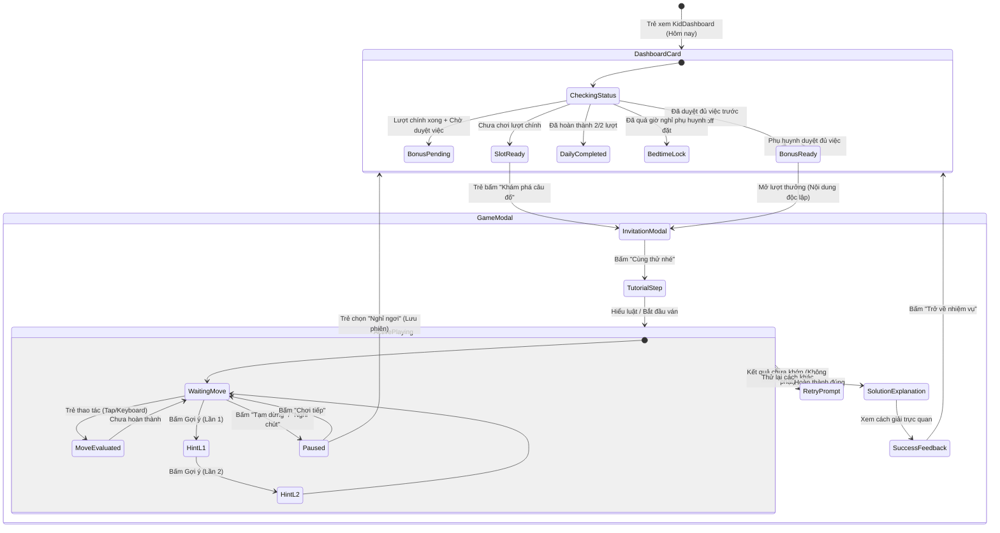
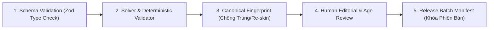

# Báo cáo Đánh giá Chuyên môn UX & Nội dung: Trò chơi Tư duy Hằng ngày (Daily Thinking Games)

> **Tài liệu**: Đánh giá UX, Nội dung, Khả năng tiếp cận & Lộ trình Kiểm định  
> **Tác giả**: Chuyên viên UX & Nội dung (Dispatched Worker AGY — Gemini 3.8 Flash High)  
> **Nhiệm vụ**: `task_49f9bff01774` | **Dispatch ID**: `ctx_45c4d9c783b3`  
> **Ngày lập**: 2026-10-21  
> **Phạm vi tác động mã nguồn**: Chỉ đọc mã nguồn hiện có; tạo tài liệu đánh giá chuyên biệt tại `plans/261021-daily-thinking-games/execution/agy-ux-content-review.md`. Tuyệt đối không sửa đổi file source hoặc contract DB/API trong đợt này.

---

## 1. Bối cảnh & Căn cứ Đánh giá

Báo cáo này được thực hiện dựa trên việc đối chiếu và phân tích sâu các nguồn tài liệu và mã nguồn hiện hữu của hệ thống:
1. **Tài liệu nghiên cứu**: [`docs/research/2026-10-17-daily-thinking-games.md`](file:///home/opc/orca/goodhabittracking/docs/research/2026-10-17-daily-thinking-games.md) và lịch biên tập [`docs/research/2026-10-17-daily-thinking-games-365.csv`](file:///home/opc/orca/goodhabittracking/docs/research/2026-10-17-daily-thinking-games-365.csv).
2. **Kế hoạch triển khai tổng thể**: `.omx/plans/daily-thinking-games-365/` bao gồm [`plan.md`](file:///home/opc/orca/goodhabittracking/.omx/plans/daily-thinking-games-365/plan.md), [`test-spec.md`](file:///home/opc/orca/goodhabittracking/.omx/plans/daily-thinking-games-365/test-spec.md), [`baseline.md`](file:///home/opc/orca/goodhabittracking/.omx/plans/daily-thinking-games-365/baseline.md), các pha chi tiết từ [`P00`](file:///home/opc/orca/goodhabittracking/.omx/plans/daily-thinking-games-365/phases/P00-baseline-and-orca-preflight.md) đến [`P11`](file:///home/opc/orca/goodhabittracking/.omx/plans/daily-thinking-games-365/phases/P11-release-and-final-handoff.md).
3. **Mã nguồn giao diện trẻ em**: [`src/components/KidDashboard.tsx`](file:///home/opc/orca/goodhabittracking/src/components/KidDashboard.tsx), [`src/components/MorningMascotLetter.tsx`](file:///home/opc/orca/goodhabittracking/src/components/MorningMascotLetter.tsx).
4. **Mã nguồn cài đặt phụ huynh**: [`src/components/ParentSettingsTab.tsx`](file:///home/opc/orca/goodhabittracking/src/components/ParentSettingsTab.tsx), [`src/lib/i18n/parent-settings-copy.ts`](file:///home/opc/orca/goodhabittracking/src/lib/i18n/parent-settings-copy.ts).
5. **Hệ thống phân tầng độ tuổi & khả năng tiếp cận**: [`src/lib/age-band.ts`](file:///home/opc/orca/goodhabittracking/src/lib/age-band.ts), [`src/components/ReadAloudButton.tsx`](file:///home/opc/orca/goodhabittracking/src/components/ReadAloudButton.tsx), [`src/lib/speech.ts`](file:///home/opc/orca/goodhabittracking/src/lib/speech.ts).
6. **Hệ thống sao chép & lời khen**: [`src/lib/i18n/kid-praise-copy.ts`](file:///home/opc/orca/goodhabittracking/src/lib/i18n/kid-praise-copy.ts), [`src/lib/i18n/kid-dashboard-copy.ts`](file:///home/opc/orca/goodhabittracking/src/lib/i18n/kid-dashboard-copy.ts).

---

## 2. Bản đồ Trạng thái (State Map) & Hệ thống Lời thoại Xưng hô "Mình – Bạn"

### 2.1. Phân tích Hiện trạng Xưng hô trong Ứng dụng
- Trong hệ thống thói quen hiện tại ([`src/lib/i18n/kid-praise-copy.ts`](file:///home/opc/orca/goodhabittracking/src/lib/i18n/kid-praise-copy.ts)), lời khen tiếng Việt đang sử dụng ngôi thứ giữa người lớn và trẻ:
  - Dải nhỏ tuổi (`young`): *"Giỏi quá con!"*, *"Con làm được rồi!"*, *"Chờ ba mẹ duyệt nhé."*
  - Dải `tween` / `teen`: *"Làm tốt lắm!"*, *"Xong việc rồi!"*, *"Chờ ba mẹ xem nhé."*
- **Quyết định UX trò chơi tư duy**: Trò chơi tư duy không phải là nhiệm vụ được giao từ phụ huynh hay bài kiểm tra của giáo viên. Linh vật đóng vai trò là **bạn đồng hành học tập (peer companion)**. Toàn bộ trải nghiệm trò chơi (lời mời, hướng dẫn, gợi ý, phản hồi thử lại, chúc mừng, thông báo lỗi, đọc âm thanh) phải sử dụng nhất quán cặp đại từ nhân xưng: **"mình – bạn"**.
- Không dùng xưng hô người lớn–trẻ ("con", "bé") trong màn hình game, không so sánh thứ hạng trí tuệ, không dùng điểm thưởng tốc độ, và không dùng lời thoại tạo cảm giác tội lỗi khi vắng mặt (zero guilt/FOMO).

### 2.2. Bản đồ Trạng thái Chi tiết (State Machine & UX Flow)

Quy trình trải nghiệm trò chơi tư duy được tổ chức thành một cỗ máy trạng thái hữu hạn (FSM) đóng kín, không có ngõ cụt:



### 2.3. Bảng Lời thoại Mẫu "Mình – Bạn" Toàn diện (Vietnamese Copy Inventory)

Mọi thông điệp xuất hiện trên giao diện game và qua Web Speech API ([`src/lib/speech.ts`](file:///home/opc/orca/goodhabittracking/src/lib/speech.ts)) đều tuân thủ nguyên tắc:

| Mã Trạng thái (State ID) | Tình huống Giao diện | Lời thoại Tiếng Việt ("mình – bạn") | Nguyên tắc Sư phạm & Tâm lý học |
| :--- | :--- | :--- | :--- |
| `ST_INVITE_MAIN` | Lời mời lượt chính đầu ngày | *"Mình có một thử thách mới hôm nay. Bạn cùng khám phá nhé?"* | Lời mời bình đẳng, không bắt buộc, kích hoạt tính tò mò tự nhiên. |
| `ST_INVITE_BONUS` | Mở lượt thưởng khi xong việc sớm | *"Bạn đã hoàn thành các nhiệm vụ đúng giờ! Mình có thêm một câu đố thưởng cho bạn đây."* | Ghi nhận sự nỗ lực với thói quen; không nói "phần thưởng cho trẻ ngoan". |
| `ST_TUTORIAL_START` | Hướng dẫn luật bằng hình ảnh | *"Bạn xem hình mẫu nhé: quy luật thay đổi theo hướng mũi tên này."* | Rõ ràng, tối đa 1-2 câu ngắn, tập trung vào điểm tựa thị giác. |
| `ST_AUDIO_READ` | Nút đọc hướng dẫn (TTS) | Nhãn: *"Nghe mình đọc"*, Trạng thái dừng: *"Dừng đọc"* | Dễ hiểu cho trẻ 6–8 chưa thành thạo chữ viết. |
| `ST_HINT_1` | Gợi ý mức 1 (Định hướng quan sát) | *"Bạn thử nhìn kỹ hai hình đầu tiên xem màu sắc thay đổi thế nào nhé."* | Không giải hộ; hướng sự chú ý vào chi tiết then chốt. |
| `ST_HINT_2` | Gợi ý mức 2 (Thu hẹp phạm vi) | *"Hình tiếp theo sẽ có cùng hình dạng nhưng đổi màu. Bạn tìm hình phù hợp nhé."* | Giảm độ khó nhận thức nhưng giữ quyền tự quyết đáp án của trẻ. |
| `ST_RETRY` | Trẻ chọn đáp án chưa đúng | *"Cách này chưa khớp rồi. Không sao cả, mình cùng thử một cách khác nhé!"* | Không dùng từ tiêu cực ("Sai rồi", "Thất bại"); bình thường hóa việc thử-sai. |
| `ST_PERSIST_PRAISE` | Trẻ kiên trì thử lại >= 2 lần | *"Bạn rất kiên trì thử nhiều cách khác nhau để tìm lời giải!"* | Khen ngợi hành vi kiên trì (Growth Mindset theo APA), không khen tư chất. |
| `ST_STRATEGY_PRAISE` | Trẻ giải nhanh sau khi dùng gợi ý | *"Bạn đã quan sát rất nhanh manh mối và hoàn thành câu đố!"* | Khen ngợi chiến lược và năng lực quan sát cụ thể. |
| `ST_EXPLANATION` | Giải thích đáp án trực quan | *"Đúng rồi! Vì mỗi bước hình tròn xoay một góc, nên hình cuối phải ở vị trí này."* | Khắc sâu logic nhận thức bằng giải thích có nguyên nhân - kết quả. |
| `ST_PAUSE_REST` | Trẻ bấm tạm dừng hoặc nghỉ | *"Mình dừng ở đây nhé. Bạn cho mắt nghỉ ngơi một chút nào!"* | Bảo vệ sức khỏe thị giác, không tạo áp lực phải chơi liên tục. |
| `ST_BEDTIME_LOCK` | Sau mốc giờ ngủ gia đình quy định | *"Đã đến giờ nghỉ ngơi rồi. Chúc bạn ngủ ngon, mai mình lại cùng chơi nhé!"* | Bình tĩnh, tôn trọng nhịp sinh hoạt, ngăn nghiện màn hình đêm muộn. |
| `ST_OFFLINE_NOTICE` | Mất kết nối mạng khi mở game | *"Mình đang chờ kết nối mạng để tải câu đố mới. Bạn đợi mình một lát nhé."* | Thông báo trung thực, không cấp lượt giả ở client khi chưa sync server. |
| `ST_APPROVAL_WAIT` | Việc xong nhưng chờ duyệt | *"Nhiệm vụ đã gửi ba mẹ rồi! Khi ba mẹ duyệt xong, lượt thưởng sẽ mở nhé."* | Giải thích rõ ràng nguyên nhân chờ, không để trẻ bối rối. |

---

## 3. Phân biệt Dải Tuổi 6–8 và 9–12 cho Đợt Thử nghiệm (Pilot 3 Games 7 Days)

### 3.1. Lý do Lựa chọn Cặp Độ tuổi 6–8 và 9–12 cho Pilot
1. **Thực trạng tại hệ thống**: [`src/lib/age-band.ts`](file:///home/opc/orca/goodhabittracking/src/lib/age-band.ts) hiện gom `young` = 3–8 tuổi và `tween` = 9–12 tuổi. Tuy nhiên, về mặt phát triển nhận thức của Piaget:
   - Trẻ 3–5 tuổi ở giai đoạn tiền thao tác (Pre-operational), chưa biết chữ, cần giao diện audio-first và cần phụ huynh chơi cùng 100%.
   - Trẻ 6–8 tuổi bước vào thao tác cụ thể (Concrete operational), bắt đầu đọc chữ cơ bản, có thể tự thao tác màn hình cảm ứng nếu nút lớn và luật đơn giản.
   - Trẻ 9–12 tuổi có tư duy logic phản biện, thao tác độc lập, đọc hiểu tốt, ghét sự áp đặt và không thích giao diện quá trẻ con.
2. **Khuyến nghị Pilot**: Tách dải thử nghiệm tiếng Việt thành 2 nhóm rõ rệt: **Nhóm 6–8 tuổi** và **Nhóm 9–12 tuổi**. Chưa đưa dải 3–5 tuổi và 13+ vào đợt pilot 7 ngày đầu để đảm bảo tính an toàn dữ liệu và kiểm soát biến số.

### 3.2. Bảng Đối chiếu Đặc tính Trải nghiệm giữa 6–8 và 9–12 Tuổi

| Tiêu chí Thiết kế | Nhóm 6–8 Tuổi (Tiểu học sớm) | Nhóm 9–12 Tuổi (Tiểu học cuối & Tween) |
| :--- | :--- | :--- |
| **Độ phức tạp câu đố** | 1 quy tắc / ràng buộc duy nhất (ví dụ: chuỗi lặp A-B-A-B; bàn cờ 3x3; mê cung không có đường nhánh cụt phức tạp). | 2–3 quy tắc kết hợp (ví dụ: chuỗi biến đổi cả hình lẫn màu; phép loại trừ 2 manh mối; ma trận 4x4). |
| **Kích thước vùng chạm (Tap Target)** | Tối thiểu **64px × 64px** theo chuẩn `TRAITS.young` trong `age-band.ts`. Khoảng cách giữa các nút >= 16px. | Tối thiểu **48px × 48px** theo chuẩn `TRAITS.tween`. Bố cục tinh gọn hơn. |
| **Độ dài câu chữ & Đọc mẫu** | Tối đa 8–12 từ/câu. Nút đọc mẫu [`ReadAloudButton`](file:///home/opc/orca/goodhabittracking/src/components/ReadAloudButton.tsx) tự động hiển thị nổi bật bên cạnh tiêu đề và hướng dẫn. | Tối đa 15–20 từ/câu. Nút đọc mẫu thu gọn thành biểu tượng phụ hoặc chỉ kích hoạt khi trẻ bấm vào. |
| **Hình tượng Linh vật (Companion)** | Linh vật xuất hiện trực tiếp (`prominent`) với cử chỉ vẫy tay, khuyến khích ấm áp. | Linh vật thu nhỏ góc màn hình (`optional`), không lặp lại hoạt ảnh nhí nhảnh. |
| **Cơ chế gợi ý (Hints)** | Gợi ý 1 chỉ thẳng vào vị trí cần nhìn (khoanh vùng thị giác). Gợi ý 2 loại bỏ 50% phương án sai. | Gợi ý 1 gợi mở nguyên lý logic ("Thử cộng hai ô trước"). Gợi ý 2 chỉ ra một phần của lời giải. |
| **Mục tiêu thời lượng** | 60–90 giây. Nếu sau 120 giây chưa xong, chủ động hiện nút gợi ý nhẹ nhàng, không cưỡng chế thoát. | 90–120 giây. Trẻ được tự do suy nghĩ lâu hơn trước khi hệ thống đề xuất gợi ý. |

---

## 4. Khả năng Tiếp cận (Accessibility: Tap, Keyboard, Mute, Reduced Motion)

Nhằm đảm bảo tuân thủ tiêu chuẩn WCAG 2.1 AA/AAA và thiết kế thân thiện cho trẻ nhỏ:

### 4.1. Cơ chế Chạm Thay thế Hoàn toàn cho Kéo Thả (Tap-to-Select Replacement for Drag & Drop)
- **Vấn đề trên thiết bị cảm ứng**: Trẻ 6–8 tuổi có cơ vân tay chưa hoàn thiện; thao tác kéo-thả (drag-and-drop) trên màn hình kính điện thoại thường xuyên gặp lỗi trượt ngón tay, kích hoạt nhầm thao tác cuộn trang (scroll), hoặc thả lệch tọa độ đích vài pixel gây ức chế tâm lý.
- **Giải pháp bắt buộc**: Mọi tương tác trong game logic (như xếp lệnh, điền chỗ trống, ghép cặp) **PHẢI hỗ trợ 100% cơ chế 2-chạm (Tap-to-Select / Tap-to-Place)**:
  1. Chạm lần 1 vào đối tượng nguồn (quân bài/hình vẽ) $\rightarrow$ Đối tượng sáng lên với viền đậm (`ring-4 ring-indigo-500 scale-105`), phát âm thanh click nhẹ, đọc nhãn ARIA `aria-selected="true"`.
  2. Chạm lần 2 vào ô đích $\rightarrow$ Đối tượng tự động di chuyển vào vị trí đích.
  3. Nếu chạm lại vào chính đối tượng hoặc chạm ra ngoài $\rightarrow$ Hủy chọn trạng thái nguồn.
- Kéo thả chỉ là một lớp nâng cao phụ (progressive enhancement), tuyệt đối không coi là phương thức điều khiển duy nhất.

### 4.2. Điều hướng Bàn phím Đầy đủ (Keyboard Navigation)
- Đảm bảo trẻ sử dụng máy tính bảng có bàn phím rời hoặc máy tính để bàn có thể chơi trọn vẹn:
  - Phím `Tab` / `Shift+Tab`: Di chuyển tuần tự qua các nút chức năng (Đóng, Tạm dừng, Âm thanh, Gợi ý, Bàn cờ).
  - Phím Mũi tên (`ArrowUp`, `ArrowDown`, `ArrowLeft`, `ArrowRight`): Di chuyển tiêu điểm giữa các ô trong ma trận câu đố.
  - Phím `Enter` hoặc `Space`: Chọn hoặc đặt phần tử vào ô đang focus.
  - Phím `Escape`: Mở modal tạm dừng/xác nhận nghỉ ngơi.
  - Lớp CSS hiển thị focus rõ nét: `focus-visible:outline-none focus-visible:ring-4 focus-visible:ring-indigo-500 dark:focus-visible:ring-indigo-400`.

### 4.3. Quản lý Âm thanh & Nút Tắt tiếng (Sound & Mute Controls)
- Tách biệt hai kênh âm thanh:
  1. **Hiệu ứng âm thanh trò chơi (SFX)**: Tiếng lách cách khi chọn quân, âm thanh êm dịu khi hoàn thành.
  2. **Âm thanh giọng đọc hướng dẫn (TTS/Voice)**: Sử dụng Web Speech API qua [`src/lib/speech.ts`](file:///home/opc/orca/goodhabittracking/src/lib/speech.ts) với ngôn ngữ `vi-VN` và tốc độ `rate: 0.85` để trẻ dễ nghe.
- Nút Tắt tiếng (Mute Toggle) được đặt ngay góc trên cùng của khung trò chơi:
  - Không bắt buộc trẻ phải mở phần cài đặt hệ thống mới tắt được âm thanh.
  - Trạng thái tắt tiếng được lưu vào `localStorage` cho phiên của trẻ, không gây gián đoạn lớp học hoặc môi trường yên tĩnh xung quanh.

### 4.4. Hỗ trợ Giảm Chuyển động (Prefers-Reduced-Motion)
- Tôn trọng thuộc tính hệ thống `prefers-reduced-motion: reduce`:
  - Loại bỏ hoàn toàn các hiệu ứng xoay lật 3D, hiệu ứng rung lắc (shake) khi chưa đúng, hoặc pháo hoa bay lượn (confetti particle animation) phức tạp.
  - Thay thế bằng chuyển đổi mờ dần đơn giản (fade transition $\le 150\text{ms}$) hoặc xuất hiện trực tiếp huy hiệu tĩnh với biểu tượng dấu kiểm xanh êm dịu.
  - Giúp phòng tránh kích ứng thị giác đối với trẻ nhạy cảm thần kinh hoặc có rối loạn phổ tự kỷ/tiền đình.

---

## 5. Bảng Điều khiển Phụ huynh (Parent Settings) & Bảo vệ Giờ ngủ Gia đình

### 5.1. Vị trí Tích hợp trên Giao diện Phụ huynh
- Trong [`src/components/ParentSettingsTab.tsx`](file:///home/opc/orca/goodhabittracking/src/components/ParentSettingsTab.tsx), thêm một nhóm thẻ cấu hình mới: **"Trò chơi tư duy hằng ngày"** (đặt tại anchor `#settings-thinking-games` hoặc bên trong phần Quản lý Trải nghiệm).
- Tương thích với cơ chế mã PIN phụ huynh (`parentPinConfigured`, `updateParentPin`): Mọi thay đổi về giờ giới hạn hoặc tắt tính năng đều đòi hỏi xác thực mã PIN nếu gia đình đã cài đặt PIN.

### 5.2. Các Thông số Cấu hình & Nguyên tắc Bảo vệ Trẻ
1. **Công tắc Bật/Tắt Toàn bộ Tính năng (Master Toggle)**:
   - Phụ huynh có toàn quyền vô hiệu hóa mục trò chơi tư duy trên Kid Dashboard nếu gia đình không muốn trẻ tiếp xúc với trò chơi màn hình.
2. **Mốc Giờ Hoàn thành Nhiệm vụ để Mở Lượt Thưởng (Bonus Cutoff Time)**:
   - Mặc định: `19:00` (7 giờ tối theo múi giờ gia đình IANA từ [`src/lib/domain/local-date.ts`](file:///home/opc/orca/goodhabittracking/src/lib/domain/local-date.ts)).
   - Trẻ hoàn thành tất cả nhiệm vụ bắt buộc trong snapshot trước mốc này $\rightarrow$ Đủ điều kiện nhận lượt thưởng.
3. **Khung Giờ Nghỉ Ngơi / Khóa Đêm (Bedtime Blackout Window)**:
   - Mặc định: Từ `20:30` đến `07:00` sáng hôm sau.
   - Trong khung giờ này, toàn bộ thẻ trò chơi trên Kid Dashboard chuyển sang trạng thái nghỉ ngơi (`ST_BEDTIME_LOCK`), bất kể trẻ đã chơi hay chưa chơi.
4. **Nguyên tắc "Không Gài Bẫy Chơi Đêm" (No Late-Night Bonus Trap)**:
   - **Tình huống thực tế**: Trẻ nộp bài lúc 18:30 (trước cutoff 19:00), nhưng ba mẹ bận việc đến 21:00 mới vào ứng dụng duyệt nhiệm vụ.
   - **Xử lý UX**: Lúc này hệ thống đã bước vào khung giờ nghỉ ngơi (sau 20:30). Hệ thống ghi nhận trẻ đã đạt điều kiện sớm (dựa trên `received_at` của máy chủ), nhưng **KHÔNG** kích hoạt thông báo mời chơi hay popup hấp dẫn làm trẻ thao thức trước giờ ngủ.
   - Giao diện Kid Dashboard sẽ hiển thị lời nhắn bình tĩnh: *"Nhiệm vụ hôm nay đã được ba mẹ duyệt rồi! Bây giờ là giờ nghỉ ngơi, mai bạn cùng mình khám phá câu đố mới nhé."* Quyền lợi này không bị mất hoặc trừ điểm, nhưng cũng không phá vỡ giờ giấc sinh hoạt.
5. **Xem trước Snapshot Nhiệm vụ (Task Snapshot Preview)**:
   - Phụ huynh có thể bấm xem danh sách nhiệm vụ được chốt ở thời điểm mở đầu ngày của trẻ, giúp giải thích minh bạch vì sao hôm nay trẻ có hoặc không có lượt thưởng, tránh tranh cãi trong gia đình.

---

## 6. Xác minh Phạm vi Nội dung 365 Ngày và 4 Dải Tuổi (Content Verification Framework)

### 6.1. Bóc tách Quy mô Thực tế: Lịch CSV vs Ngân hàng Đề Chơi được
- Cần khẳng định một thực tế quan trọng: File [`docs/research/2026-10-17-daily-thinking-games-365.csv`](file:///home/opc/orca/goodhabittracking/docs/research/2026-10-17-daily-thinking-games-365.csv) là **lịch biên tập chủ đề (editorial syllabus)** với 365 dòng, 730 vị trí slot (`D001-main` đến `D365-bonus`), nhưng trạng thái hiện tại của toàn bộ các dòng đều là `design_only`.
- Để có một sản phẩm hoàn chỉnh:
  - Mỗi slot cần một file cấu trúc dữ liệu chơi được (JSON payload).
  - Với 4 dải tuổi (3–5, 6–8, 9–12, 13+), quy mô tối đa là:
    $$730 \text{ slots} \times 4 \text{ age tracks} = 2.920 \text{ payload phiên bản}.$$
  - Nếu tính thêm đa ngôn ngữ (9 ngôn ngữ chính trong hệ thống i18n của app), con số sẽ nhân lên gấp bội. Do đó, việc tự nhận "đã có sẵn 365 ngày game" là hoàn toàn sai lệch nếu chưa biên soạn và kiểm định từng payload.

### 6.2. Quy trình Kiểm định 5 Tầng Chặt chẽ Trước khi Đóng gói (5-Layer Content Pipeline)

Mỗi file câu đố phát hành phải đi qua 5 cửa ải kiểm duyệt tự động và con người:



1. **Tầng 1 - Kiểm tra Khung Dữ liệu (Schema Validation)**:
   - Kiểm tra bằng Zod schema: `id`, `dayIndex` (1-365), `slotType` (`main` | `bonus`), `skillGroup` (1 trong 8 nhóm), `gameTypeId` (1 trong 24 dạng), `ageTrack` (`young` | `tween`), `boardData`, `solution`, `hints` (đúng 2 cấp độ), `behaviorPraiseKeys`.
2. **Tầng 2 - Bộ Giải Thuật toán Độc lập (Algorithmic Solver Verification)**:
   - Mỗi câu đố dạng một đáp án phải có script chạy solver chứng minh:
     - Câu đố có nghiệm hợp lệ (không phải đề bất khả giải).
     - Nghiệm là **duy nhất** (với câu đố thiết kế nghiệm duy nhất) hoặc tập nghiệm đóng hữu hạn (với câu đố tìm đường/nhiều nghiệm).
     - Các manh mối và gợi ý không mâu thuẫn với đáp án.
3. **Tầng 3 - Dấu vân tay Cấu trúc (Canonical Structural Fingerprinting)**:
   - Áp dụng thuật toán băm chuẩn hóa (bỏ qua màu sắc, icon, tên gọi, xoay gương 90/180 độ) để tạo ra mã hash cấu trúc của câu đố.
   - Nếu hai câu đố có cùng mã hash cấu trúc xuất hiện trong cùng một khoảng thời gian $\le 30$ ngày $\rightarrow$ Hệ thống tự động từ chối, ngăn chặn việc chỉ đổi skin trái táo thành trái cam mà coi là đề mới.
4. **Tầng 4 - Soát xét Ý nghĩa & Độ tuổi bởi Con người (Human Editorial Review)**:
   - Giáo viên/biên tập viên kiểm tra trực tiếp: Ngôn ngữ tiếng Việt tự nhiên, chuẩn mực xưng hô "mình – bạn", không có yếu tố văn hóa gây hiểu nhầm, và mức độ phù hợp với năng lực nhận thức của trẻ lứa tuổi đó.
5. **Tầng 5 - Đóng gói theo 5 Đợt Phát hành (Release Batch Manifests)**:
   - Chia 365 ngày thành 5 đợt kiểm định:
     - **Đợt 1**: Ngày 1 – 28 (Chương 1: Khu vườn khám phá) $\rightarrow$ 56 slots/track.
     - **Đợt 2**: Ngày 29 – 91 (Chương 2-3) $\rightarrow$ 126 slots/track.
     - **Đợt 3**: Ngày 92 – 182 (Chương 4-6) $\rightarrow$ 182 slots/track.
     - **Đợt 4**: Ngày 183 – 273 (Chương 7-9) $\rightarrow$ 182 slots/track.
     - **Đợt 5**: Ngày 274 – 365 (Chương 10-12 & Kết) $\rightarrow$ 184 slots/track.
   - Chỉ gắn nhãn "Hoàn thành 365 ngày" khi toàn bộ 5 đợt của track đó đã vượt qua cả 5 tầng kiểm định và có chữ ký nghiệm thu trong manifest.

---

## 7. Cảnh báo Ngoại lệ: Khoảng cách Dạng trò giữa Prototype (3 dạng) và Bản chính thức (24 dạng)

### 7.1. Bản chất của Ràng buộc Khoảng cách Dạng trò (Spacing Invariant)
- Trong tài liệu nghiên cứu và thiết kế bản 365 ngày:
  - Toàn bộ hệ thống có **24 dạng trò** thuộc 8 nhóm kỹ năng.
  - Mỗi ngày có 2 lượt (main và bonus) thuộc 2 nhóm kỹ năng khác nhau.
  - Trong CSV 365 ngày, thuật toán xếp lịch đã bảo đảm khoảng cách thực tế giữa hai lần xuất hiện cùng một dạng trò là **tối thiểu 11 ngày** (và theo nguyên tắc sản phẩm là không được nhỏ hơn 7 ngày).

### 7.2. Sự Xung đột Toán học Bắt buộc ở Prototype 3 Dạng trong 7 Ngày
- Trong giai đoạn mẫu thử (Prototype / Vertical Slice P05):
  - Nhóm phát triển chỉ triển khai **3 dạng trò đại diện**:
    1. `g01-t1`: Quy luật (Điền phần tiếp theo)
    2. `g02-t1` hoặc `g06-t1`: Không gian / Lập kế hoạch (Ghép bóng hoặc Tìm đường)
    3. `g03-t1`: Trí nhớ (Nhớ thứ tự hoặc Nhớ vị trí)
  - Thử nghiệm diễn ra trong **7 ngày liên tục**, mỗi ngày 2 slot = **14 vị trí chơi**.
- **Mâu thuẫn toán học (Nguyên lý Dirichlet / Pigeonhole Principle)**:
  - Khi phân bổ 14 vị trí chơi cho 3 dạng trò, trung bình mỗi dạng trò phải xuất hiện:
    $$\frac{14}{3} \approx 4{,}67 \text{ lần trong 7 ngày}.$$
  - Do đó, khoảng cách trung bình giữa hai lần lặp lại cùng một dạng trò trong đợt thử nghiệm 7 ngày chỉ là **1 đến 2 ngày**. Hoàn toàn **không thể** đạt được khoảng cách $\ge 7$ hay $\ge 11$ ngày như bản 365 ngày!

### 7.3. Khuyến nghị Giải pháp Kỹ thuật
- **Cảnh báo đội ngũ Kỹ thuật & QA**:
  - Không được áp dụng bộ kiểm tra tự động (automated validation rule) của bản 365 ngày (vốn đòi hỏi `format_spacing >= 7 days`) vào manifest dữ liệu của đợt pilot 7 ngày.
  - Trong trình biên dịch / kiểm tra manifest (`catalog-validator`), phải tạo cờ phân định rõ ràng:
    ```typescript
    interface CatalogValidationOptions {
      readonly isPilotFixture?: boolean; // Nếu true, bỏ qua ràng buộc format_spacing >= 7 days
      readonly minFormatSpacingDays?: number;
    }
    ```
  - Trong tài liệu bàn giao P05, phải ghi rõ: *“Ngoại lệ lặp dạng trò trong Prototype 7 ngày được phê duyệt có chủ đích nhằm kiểm thử độ bền của 3 cơ chế renderer đầu tiên, không xem đây là lỗi vi phạm kiến trúc 365 ngày.”*

---

## 8. Phân định MVP (Vertical Slice / Pilot) vs Sản phẩm Trọn năm & Cổng Kiểm định Con người Trung thực

### 8.1. Ranh giới Rõ ràng giữa MVP và Toàn niên (All-Year Scope)

| Hạng mục So sánh | Giai đoạn MVP (Vertical Slice P05 & Pilot P10) | Giai đoạn Toàn niên (All-Year Release) |
| :--- | :--- | :--- |
| **Số lượng cơ chế trò chơi** | **3 cơ chế** cốt lõi (Quy luật, Không gian, Trí nhớ). | Đầy đủ **24 cơ chế** thuộc 8 nhóm tư duy nhận thức. |
| **Quy mô nội dung** | **7 ngày** $\times$ 2 slot = 14 câu đố cho mỗi track tuổi được chọn. | **365 ngày** $\times$ 2 slot = 730 câu đố cho mỗi track tuổi. |
| **Dải tuổi hỗ trợ** | Giới hạn ở 2 nhóm chính: **6–8 tuổi** và **9–12 tuổi**. | Mở rộng đủ 4 dải tuổi: **3–5**, **6–8**, **9–12**, và **13+**. |
| **Phạm vi ngôn ngữ** | Tiếng Việt (`vi`) hoàn chỉnh. | Đầy đủ 9 ngôn ngữ theo hệ thống i18n của ứng dụng. |
| **Mục tiêu giai đoạn** | Xác minh tính mượt mà của luồng (dashboard $\rightarrow$ modal $\rightarrow$ play $\rightarrow$ sync), kiểm chứng thời lượng 60–120s và phản ứng tâm lý của trẻ. | Đồng hành dài hạn 1 năm, duy trì thói quen rèn luyện tư duy nhẹ nhàng hằng ngày. |

### 8.2. Cam kết Đạo đức & Cổng Kiểm định Con người Trung thực (Honest Human Validation Gates)
- **TUYỆT ĐỐI KHÔNG TUYÊN BỐ SAI SỰ THẬT**:
  - Trong giai đoạn lập kế hoạch và viết code, tuyệt đối không được báo cáo hoặc đưa ra nhận định kiểu: *"Đã cho trẻ chơi thử và trẻ rất thích"*, *"Trò chơi giúp trẻ tăng chỉ số IQ"*, hoặc bịa đặt kết quả khảo sát người dùng khi chưa tổ chức nghiên cứu lâm sàng/thực nghiệm thực tế.
- **Quy trình Khảo sát Thực tế Bắt buộc tại Pha P10**:
  1. **Đồng thuận của Phụ huynh (Informed Consent)**: Chỉ triển khai thử nghiệm trên tập trẻ em có phụ huynh đăng ký tự nguyện, hiểu rõ phạm vi thử nghiệm và ký đồng thuận kỹ thuật số.
  2. **Bộ Chỉ số Đo lường Khách quan (Objective Telemetry)**:
     - Đo thời gian ván chơi thực tế (active time), trừ thời gian tạm dừng/mất mạng $\rightarrow$ Kiểm chứng tiêu chí $\ge 80\%$ ván chơi kết thúc trong 60–120 giây.
     - Đo tỷ lệ hiểu luật ngay sau màn hình ví dụ mẫu mà không cần phụ huynh can thiệp $\rightarrow$ Mục tiêu $\ge 80\%$.
     - Ghi nhận tần suất bấm gợi ý, số lần thử lại, và tỷ lệ bấm bỏ ngang giữa ván (exit rate).
  3. **Kiểm tra Tác động Tiêu cực tới Thói quen Gia đình**:
     - Theo dõi tỷ lệ phụ huynh từ chối (reject) hoặc yêu cầu làm lại thói quen hằng ngày. Nếu tỷ lệ này tăng vọt trong đợt thử nghiệm game $\rightarrow$ Bằng chứng trẻ đang làm vội/làm ẩu để mở khóa game $\rightarrow$ Cần điều chỉnh ngay chính sách cutoff và cách hiển thị phần thưởng.
  4. **Cơ chế Dừng Khẩn cấp (Stop Criteria)**:
     - Nếu phát hiện $> 20\%$ trẻ ở dải 6–8 tuổi gặp khó khăn vượt quá 180 giây ở một dạng bài, hoặc có biểu hiện bực bội/khóc/nản lòng, lập tức dừng đợt thử nghiệm của dạng bài đó để chuyển về khâu thiết kế lại mức độ sư phạm.

---

## 9. Khuyến nghị Kế hoạch Hành động Tiếp theo cho Đội ngũ

1. **Dành cho Đội ngũ Engine & Generator (OpenCode)**:
   - Khi hiện thực hóa P03/P05, thiết kế cấu trúc dữ liệu câu đố tách rời giao diện.
   - Tích hợp cờ `isPilotFixture` vào công cụ kiểm tra để không làm gãy build do vi phạm khoảng cách 24 dạng trò.
   - Xây dựng cơ chế tap-to-select ngay từ cấp độ component nền tảng.
2. **Dành cho Đội ngũ QA & Kiểm thử (Kilo Code)**:
   - Thiết lập bộ test tự động kiểm tra cú pháp Zod cho toàn bộ 14 payload của đợt pilot 7 ngày.
   - Thẩm tra toàn bộ các chuỗi ký tự trong i18n để đảm bảo $100\%$ tuân thủ ngôi xưng "mình – bạn", không sót bất kỳ từ "con", "bé" hay đại từ người lớn nào trong luồng game.
   - Kiểm tra a11y tự động (axe-core) và thao tác bàn phím thực tế trên trình duyệt thật (Playwright).
3. **Dành cho Điều phối viên (Codex / OMP)**:
   - Giữ nguyên các file đang làm dở của các nhánh khác.
   - Chỉ mở cổng chuyển từ MVP sang All-Year sau khi có báo cáo thực nghiệm con người trung thực từ P10 được chấp thuận.

---
*Báo cáo được hoàn thiện và lưu trữ tại `plans/261021-daily-thinking-games/execution/agy-ux-content-review.md` phục vụ việc tham chiếu triển khai.*
