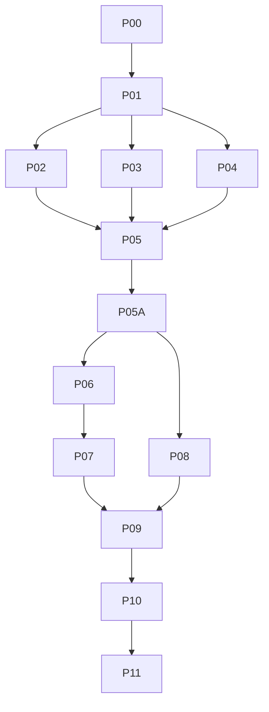

# Kế hoạch triển khai trò chơi tư duy hằng ngày (versioned)

Ngày: 2026-10-21. Phiên bản: `plan-2026-10-21`.
Trạng thái: **P01 contracts ready for independent review**. Chưa triển khai engine/backend/content, chưa chạy migration, chưa commit, chưa thêm dependency, chưa deploy.

Phạm vi ghi của lượt này chỉ là thư mục `plans/261021-daily-thinking-games/`: `plan.md`, `test-spec.md`, `phases/**`, `handoffs/**`, `contracts.md`, `decisions.md`, `prd.md`, `execution/contracts-handoff.md`. Không sửa source, SQL, package hay test.

## 1. Mục tiêu

Xây một trải nghiệm trò chơi tư duy ngắn, an toàn, có thể kiểm chứng cho trẻ, với:

- một hành trình cá nhân 365 ngày, không phạt vắng mặt;
- tối đa hai lượt/ngày địa phương: `main` độc lập và `bonus` theo điều kiện nhiệm vụ;
- 24 cơ chế, 96 biến thể quy tắc, 8 nhóm tư duy;
- lời thoại tiếng Việt `mình – bạn`, không FOMO, không chấm tốc độ, không xếp hạng trí tuệ;
- quyền phụ huynh rõ ràng, PIN, giờ ngủ, snapshot nhiệm vụ;
- server là nguồn quyền duy nhất; offline không tạo quyền giả.

Bản phát hành đầu chỉ gồm **tiếng Việt, tuổi 6–8 và 9–12, 3 cơ chế trong 7 ngày**. Bốn dải tuổi và 365 ngày đầy đủ là milestone sau, không được tuyên bố đã xong.

## 2. Nguồn và bằng chứng hiện tại

- [Nghiên cứu](../../docs/research/2026-10-17-daily-thinking-games.md)
- [CSV 365 ngày](../../docs/research/2026-10-17-daily-thinking-games-365.csv)
- [PRD](./prd.md), [contracts](./contracts.md), [decisions](./decisions.md), [test spec](./test-spec.md)
- Báo cáo UX/nội dung độc lập: [agy-ux-content-review.md](./execution/agy-ux-content-review.md)

Đo lại ngày 2026-10-21:

| Bằng chứng | Giá trị | Ý nghĩa |
| --- | --- | --- |
| CSV rows / slots | 365 / 730 | Lịch biên tập |
| `type_id` | 24 | 24 cơ chế |
| `(type_id, rule_variant)` | 96 | 96 biến thể, **không phải** 96 cơ chế |
| `main_skill == bonus_skill` | 0 / 365 | Đúng thiết kế |
| `main_skill != bonus_skill` | 365 / 365 | Phải giữ sau mọi thay đổi |
| Cửa sổ 8 ngày đủ 8 nhóm | 358 / 358 | Invariant |
| Khoảng cách format nhỏ nhất | 11 ngày | Chuẩn sản xuất ≥ 7 |
| Payload chơi được đã duyệt | 0 / 730 | **Chưa có 365 ngày** |
| Trạng thái CSV | `design_only` toàn bộ | Không được phát hành |

Báo cáo Cline từng ghi 0/365 ngày khác nhóm là **sai**; phép đếm equal/different ở trên là bằng chứng chuẩn.

### 2.1 Bằng chứng source hiện tại (snapshot, cần đối chiếu lại trước khi sửa)

| Vị trí | Điều đã thấy | Hệ quả contract |
| --- | --- | --- |
| `src/lib/domain/local-date.ts:1` | Helper ngày theo IANA | Tái dùng semantics; server quyết định ngày |
| `src/lib/domain/commands.ts:44` | Command hiện có complete/undo/review/reviewHabits/redeem... | Game command là bổ sung mới; không nhét game vào command cũ |
| `src/app/api/child/commands/route.ts:43` | Cross-site check, child cookie, RPC | Dùng cùng ranh giới auth |
| `supabase/migrations/202609300004_authoritative_command_hardening.sql` | complete/undo/review single; lock log→child | Phải thêm child-scoped advisory lock trước row lock |
| `supabase/migrations/202610040001_review_habits_batch.sql` | Batch review log→child, comment lock order | Bonus sync **một lần** sau batch |
| `supabase/migrations/202610090030_family_operations_hardening.sql` | Bản hiện hành complete/undo/review | Nguồn lock order thực tế cần sửa |
| `supabase/migrations/202610050001_pin_gated_server_wrappers.sql` | `*_as` wrappers service_role + `act_as_user` | Parent settings dùng cùng pattern PIN |
| `src/lib/experience-flags.ts:3` | Flag registry, quest/secret false | Thêm flag game riêng, mặc định false |
| `src/lib/age-band.ts:8` | young 3–8 / tween 9–12 / teen | Game cần track 6–8 và 9–12 riêng; không lạm dụng theme |
| `src/lib/i18n/kid-praise-copy.ts:1` | Copy hiện dùng “con/bé” | Không sửa lặng lẽ habit flow; game có module copy riêng |
| `src/components/KidDashboard.tsx:204` | Ngày thiết bị, lọc việc đến hạn | Không lấy browser date/progress làm quyền |
| `src/components/ParentSettingsTab.tsx:92` | `parentPinConfigured`, `updateParentPin` | Anchor/settings mới phải đi qua PIN hiện có |
| `supabase/migrations/202609190001_family_tenancy.sql:232` | `parent_settings` chưa có timezone game | Cần bảng settings game riêng hoặc cột additive |
| `package.json:14` | Toolchain lint/typecheck/test/e2e/a11y/perf | Dùng toolchain hiện có, không thêm dependency |

## 3. Quyết định đã khóa

Chi tiết đầy đủ ở [decisions.md](./decisions.md) và [contracts.md](./contracts.md). Tóm tắt:

1. Ngày địa phương do server tính từ IANA timezone của gia đình; không đoán, không dùng đồng hồ thiết bị.
2. Snapshot ngày được tạo lười và bất biến; đổi setting có hiệu lực ngày kế tiếp, trừ tắt tính năng có hiệu lực ngay.
3. `main` độc lập nhiệm vụ; `bonus` cần toàn bộ nhiệm vụ bắt buộc trong snapshot thành công và `received_at` trước cutoff.
4. `received_at` là giờ server lúc ghi log; `reviewed_at` tách riêng. Duyệt muộn không làm mất tính đúng giờ.
5. Tối đa hai entitlement/ngày; attempt dở qua ngày bị đóng `abandoned_rollover`, không có lượt thứ ba.
6. Offline không cấp quyền mới; chỉ resume attempt đã được server gán; finish retry idempotent, không backdate.
7. Quyền chơi game là ledger riêng, không sửa trạng thái/điểm của habit đã duyệt.
8. Undo trước khi bonus start → `revoked_unused`; sau khi start → `revoked_after_use`, giữ lịch sử, không cấp bù.
9. Single review và batch review dùng cùng một bonus sync; batch gọi một lần sau toàn bộ batch.
10. Lock order chung bắt đầu bằng advisory lock theo `child_id`, rồi device/activity/log/child/settings/snapshot/entitlement/attempt.
11. Bản đầu: `vi`, `age_6_8`, `age_9_12`; 3–5, 13+, bốn track/năm là milestone sau.
12. Pilot 3 format/7 ngày dùng manifest riêng, exception spacing rõ ràng; không tính vào coverage 24/730.
13. Flag game mặc định false; bonus/pilot flag riêng, fail closed.
14. Không thêm dependency; không dùng live generation.

## 4. Phạm vi phát hành và milestone

| Milestone | Nội dung | Điều kiện thoát |
| --- | --- | --- |
| M0 | P00 baseline, P01 contracts | Independent review ACCEPTED |
| M1 | P02 UX, P03 engine, P04 server | Contract + local SQL race/RLS pass |
| M2 | P05 3 cơ chế/7 ngày/2 track, pilot manifest | Real browser start→resume→finish; spacing exception ghi rõ |
| M3 | P05A early usability checkpoint | Quan sát trẻ thật 6–8/9–12 hoặc **BLOCKED** |
| M4 | P06 24 cơ chế, P07 365 ngày | Payload approved/solver/fingerprint/human sign-off |
| M5 | P08 integration, P09 QA | Zero P1/P2; a11y/perf/regression evidence |
| M6 | P10 pilot, P11 release | Human pilot report; rollout/rollback drill |

**P05A là gate bắt buộc trước P06/P07.** Không dùng 3 format/7 ngày để tuyên bố 24 format hoặc 365 ngày.

## 5. Phân công dự kiến (chưa dispatch trong lượt này)

| Vai trò | Quyền chính | Không tự làm |
| --- | --- | --- |
| Root/Codex | Contract review, backend nhạy cảm, integration, release | Không tự nhận independent review; không bỏ gate |
| OpenCode | Engine TypeScript thuần, generator/solver, tests unit | Không sửa dashboard/store/SQL ngoài phase |
| Kilo | QA độc lập, API/SQL/e2e/a11y, evidence | Không giảm assert để pass |
| AGY | UX/copy `mình–bạn`, content batch, age review | Không quyết định entitlement/RLS/migration |
| P04 backend owner | Migration/RPC/API, local preflight/rollback | Không áp production khi chưa được lệnh |
| P10 pilot owner | Consent, observation, aggregate results | Không bịa người dùng/feedback |

Giới hạn: tối đa 3 lane ghi rời nhau; một owner/file; shared file (`KidDashboard`, store, flags, command schema, package, i18n registry) phải lock và nhận base SHA mới nhất trước P08.

## 6. Phase và handoff

| Phase | Công việc | Gate chính |
| --- | --- | --- |
| [P00](./phases/P00-baseline-and-orca-preflight.md) | Baseline, provenance, locks | SHA/dirty/CSV facts; no source edits |
| [P01](./phases/P01-product-and-contracts.md) | PRD + contracts + decisions + GWT | Mọi quyết định có expected behavior; version khóa |
| [P02](./phases/P02-experience-and-copy.md) | UX flow, copy, parent settings | No dead end; `mình–bạn`; tap/keyboard |
| [P03](./phases/P03-engine-and-scheduler.md) | Engine, registry, scheduler, validators | Deterministic, solver, spacing |
| [P04](./phases/P04-server-entitlements.md) | DB/RLS/RPC, ledger, locks, offline | Real SQL race/RLS; common lock order |
| [P05](./phases/P05-vertical-slice.md) | 3 mechanics, 7 days, pilot manifest | Server-backed flow; explicit spacing exception |
| [P05A](./phases/P05A-early-usability-checkpoint.md) | Usability checkpoint before year content | Real age observation or BLOCKED |
| [P06](./phases/P06-all-game-mechanics.md) | 21 mechanics còn lại | 24/24 renderer/checker/hints/a11y |
| [P07](./phases/P07-content-365-days.md) | 365×2 payloads per released track | Approved content only; 24/96 coverage |
| [P08](./phases/P08-app-integration.md) | Dashboard, parent controls, store | Flag off safe; shared lock respected |
| [P09](./phases/P09-system-verification.md) | Full QA | Zero P1/P2; real SQL/browser evidence |
| [P10](./phases/P10-controlled-pilot.md) | Controlled pilot by age | Human report; stop criteria |
| [P11](./phases/P11-release-and-final-handoff.md) | Release/rollback/ops | Kill switch drill; scope claims true |

Handoff template tương ứng ở [handoffs/](./handoffs/). Template chưa điền không phải receipt hoàn thành. Mỗi handoff phải có owner, task/dispatch/run, SHA, base/dirty, contract version, commands/exit codes, environment, findings, rollback, next owner, verdict ACCEPTED/REWORK/BLOCKED.

## 7. DAG

P02/P03/P04 chạy song song sau P01. P05A chặn P06/P07 và mọi tuyên bố “năm học”. P07 chia batch 1–28, 29–91, 92–182, 183–273, 274–365; mỗi batch phải có audit và receiver verdict. P08 chỉ sửa dashboard khi lane UI nhả lock.

## 8. Atomic bonus integration

Chi tiết ở [contracts §8](./contracts.md#8-atomic-habit-integration-and-common-lock-order). Tóm tắt bắt buộc:

- P04 sửa `complete_habit_command`, `complete_child_habit_command`, `undo_habit_command`, `undo_child_habit_command`, `review_habit_command`, `review_habits_command` để gọi `sync_thinking_game_bonus_for_child` **trong cùng transaction**.
- Batch review gọi đúng **một lần** sau vòng lặp, tránh grant/revoke tạm thời.
- Mọi đường ghi lấy `pg_advisory_xact_lock` theo `child_id` tăng dần trước, sau đó row lock theo thứ tự device → activity → log → child → settings → snapshot → entitlement → attempt.
- `complete_*` phải pre-check unique `(activity_id, child_id, log_date)` dưới advisory lock rồi mới lock child/insert, đóng inversion hiện tại.
- Revoke game không đổi `activity_logs.status/points`; habit approved là terminal, trừ chính sách habit hiện có.
- Nếu không thể sửa một RPC theo lock order, bonus flag phải off; không được “best effort”.

## 9. Acceptance criteria toàn tính năng

Giữ AC01–AC14, cập nhật cho phạm vi thật:

- **AC01** Hai slot/ngày địa phương trên mọi tab/thiết bị; 20 start đồng thời → một entitlement/attempt.
- **AC02** Main luôn có khi feature bật, timezone hợp lệ, content approved; empty-day không tự bonus; wrong/hint/rest không trừ sao.
- **AC03** Bonus dùng snapshot + `received_at` + approval; race approve/reject/undo/start nhất quán; client timestamp không backdate.
- **AC04** Family/child isolation, revoked session, cross-site fail closed; RLS/RPC kiểm bằng PostgreSQL thật.
- **AC05** Journey không nhảy do refresh/tab/bonus/timezone; rollover và attempt dở đúng contract.
- **AC06** 24/24 cơ chế có payload/checker/hints/renderer/a11y; multi-answer chấp nhận mọi lời giải hợp lệ.
- **AC07** Track phát hành có đủ 365 main + 365 bonus, approved, versioned. Bản đầu chỉ 6–8/9–12/vi; bốn track tối đa 2,920 payload/track-locale. Không tuyên bố hoàn thành khi chỉ có pilot.
- **AC08** 24 type id + 96 variant pair + 8 nhóm; bonus khác nhóm main; spacing ≥7; fingerprint chống trùng; CSV hiện 11 ngày.
- **AC09** Toàn bộ copy game tiếng Việt `mình–bạn`, kể cả error/empty/voice/notification; không đổi habit flow.
- **AC10** 375px/desktop không overflow; keyboard/tap/screen-reader/reduced-motion/mute; không serious/critical a11y mới.
- **AC11** P05A/P10: ≥80% ván không gián đoạn 60–120 giây và ≥80% hiểu luật, theo từng track, báo mẫu/phân bố. Không claim IQ.
- **AC12** Không tăng reject/rush đáng kể so baseline; mẫu nhỏ không kết luận nhân quả.
- **AC13** CI lint/typecheck/unit/API/integration/e2e phù hợp pass; migration apply/rollback local pass; perf budget; lazy load, không prefetch cả năm.
- **AC14** Feature off/migration thiếu/timezone thiếu/content version lỗi/network mất có trạng thái phục hồi; kill switch drill; không xóa dữ liệu.

## 10. Rủi ro và giảm thiểu

| Rủi ro | Giảm thiểu |
| --- | --- |
| CSV bị nhầm là 730 câu đố | Approved payload gate; 0/730 được ghi rõ |
| 24 format bị nhầm với 96 variant | Validator báo riêng `typeIds` và `variantPairs` |
| Pilot không thể đạt spacing 7 ngày | Pilot manifest riêng + exception có tên người duyệt |
| Bonus grant/revoke đua với review/undo | Advisory lock theo child + row order + sync một lần/batch |
| Game revoke làm hỏng habit approved | Ledger riêng; không sửa status/points |
| Qua nửa đêm/offline | Attempt thuộc ngày bắt đầu; rollover đóng; không lượt bù |
| Tuổi thiếu bị đoán | `age_track_unavailable`; không fallback |
| Bốn track tăng phạm vi | Bản đầu 6–12; 3–5/13+ là milestone sau |
| Kế hoạch bị coi là đã xây | Mọi status tách LOCKED / BUILT / PASS; pilot người thật PENDING |

## 11. Kiểm chứng và phát hành

Test matrix ở [test-spec.md](./test-spec.md). Thứ tự: unit/contract → local SQL/RLS/concurrency → API/session → real browser shared state → a11y/visual/perf → early usability → controlled pilot → release.

Lệnh hiện có (chỉ chạy khi code tồn tại): `npm run lint`, `npm run typecheck`, `npm run test:unit`, `npm run test:api`, `npm run test:integration`, `npm run test:e2e`, `npm run test:a11y`, `npm run check:secrets`, `npm run check:audit`, `npm run build:cloudflare`, `npm run check:performance`, `npm run ci`.

Lượt này không chạy các lệnh trên vì không sửa source. Không có dependency mới. Không commit/push/deploy.

## 12. Trạng thái historical và điều kiện kết thúc

- `.omx/plans/daily-thinking-games-365/` là bản kế hoạch **lịch sử 2026-10-17**. Các coordination/failed dispatch/runtime blocker ở đó không phải bằng chứng hiện tại. Bản versioned này thay thế nó cho P01.
- `baseline.md`, `coordination.md`, `file-locks.md` không được copy vào scope này vì ngoài write scope; nội dung lịch sử được ghi tại đây và trong [execution/contracts-handoff.md](./execution/contracts-handoff.md).
- Kết thúc lượt P01 khi: contracts/decisions/PRD/test-spec/plan + 13 phase + 13 handoff tồn tại; links đúng; không có quyết định thiếu bị đánh dấu done.
- **Chưa** bắt đầu engine/backend; **chưa** có independent review; **chưa** có human pilot; **chưa** có content semantic approval.
